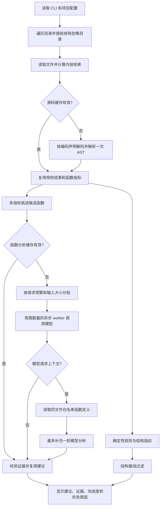

# v0.3 改动说明：从能运行到可控、可解释的巡检

这份文档按“为什么改 → 怎么实现 → 怎么使用 → 如何验证”介绍本轮改动。历史版本的真实 LLM 测评见 [原报告](validation/2026-10-10-llm-report.md)，新版本的测量结果另存为 `benchmarks/results/2026-10-10-improvements/`。

## 1. 一张图理解现在的流程



LangGraph 的顶层仍是四个节点。上下文请求、工具查找、二次分析发生在 LLM 节点内部。它具备有限的“分析后决定是否调用工具”的流程；没有自动执行目标代码或自动修改仓库。

## 2. 文件怎么分工

| 文件 | 主要职责 |
|---|---|
| `source_analysis.py`（新增） | 按编码声明读取；提取函数、限定名与复杂度指标 |
| `inspection_cache.py`（新增） | 带有效期的 JSON 缓存、损坏降级、临时文件原子替换 |
| `llm_protocol.py`（新增） | 提示词、严格响应协议、证据校验和同文件定义查找 |
| `llm_runtime.py`（新增） | 分批、并发限制、预算、函数缓存、一轮上下文补查、状态统计 |
| `rules.py` | 复用 AST、运行规则、生成结构指纹、产出函数候选与定义索引 |
| `llm_node.py` | 读取模型配置，连接共享状态与 LLM 执行器 |
| `baseline.py` | 写入 v2 结构基线，同时读取旧 v1 行号基线 |
| `main.py` / `report.py` | 新缓存选项、JSON 状态统计、Markdown 证据和未完成提示 |
| `test_improvements.py` | 针对本轮实测局限和审查反馈的回归用例 |

## 3. 候选筛选：文档长不再等于函数复杂

旧版只看函数起止行号，30 行文档也会触发模型调用。新版计算以下指标，满足任一条件就入选：

- 有效源码行 ≥ `long-func-threshold`，默认 30。
- 控制结构最大嵌套深度 ≥ 4。
- 分支数量 ≥ 8。
- 相同赋值、表达式或返回语句重复 ≥ 3 次。
- 参数数量 ≥ 10，并且分支数量 ≥ 2。

有效行按 Python token 所在行计算，排除注释、空行与 docstring；它是筛选指标，并不等同于运行时执行次数或严格的可执行语句数。嵌套计数包含 if、循环、try、with、match；不是正式认知复杂度算法。

如果已经选择外层函数，就不再单独发送其内部函数，避免重复上传。完整函数文档仍保留给模型理解用途。当前除行数阈值外，其他阈值在 `select_candidates` 中固定，后续可在有评测依据时调整。

**局限：**筛选不能保证覆盖所有坏味道。减少候选不等于召回率提高；短小但有业务错误的函数仍可能不入选。

## 4. 模型必须交出证据

每条建议必须提供函数 ID、类别、连续行范围、对应原文、影响和修改建议。行范围以函数片段第 1 行为起点，本地转换为真实文件行号。

例如：

```json
{
  "findings": [{
    "function_id": "example.py:calculate#1",
    "category": "重复赋值",
    "evidence_lines": [2, 3],
    "evidence": "    total = 0\n    total = 0",
    "impact": "重复初始化增加维护噪声",
    "suggestion": "保留一次初始化",
    "needs_context": false
  }],
  "context_requests": []
}
```

本地检查 ID、字段类型、非空文本、行号范围和源码是否匹配。无效条目会计入 `rejected_items`；其他合法条目仍保留。相同函数、类别、证据范围和原文的重复条目只保留一次。语义相同但措辞或证据不同的建议仍可能重复。

提示词明确允许无发现，并禁止只因协议常量、局部导入、文档长或公开 API 参数多而认定有问题。temperature 调为 0 可以降低部分波动，但不保证确定性。

**证据能对上源码，只说明位置真实，不证明推理正确。** 所有模型建议仍应复核。

## 5. 上下文工具：有边界的补查

模型可以请求 `context_requests`，例如询问被调用的 `helper` 的实现。工具只返回：

1. 当前函数实际直接调用过的名称；
2. 同文件、唯一的顶层函数定义；
3. 索引中已读取的源码，最多 4 项且受字符上限约束。

不接受文件路径，不读取 `.env`，不运行代码；目前不解析跨文件 import、动态调用或 `self.method()`。查不到、超出预算、第二轮仍要求更多上下文时，结果会显示未完成。第二轮最多一次，避免无限循环。

这个范围刻意有限。它能帮助理解同文件辅助函数，不能声称已经实现跨仓库语义推理。

## 6. 缓存与增量复用

默认在被扫描项目的 `.inspect-cache/` 中保存两类结果：

- **源码缓存：**相对路径、文件内容哈希、规则和分析版本、相关配置相同，复用规则结果和函数指标。文件仍需读取计算哈希，但不用重复解析 AST。
- **函数分析缓存：**函数记录、同文件定义上下文、模型端点和名称、提示词版本、LLM 配置相同，复用已经完成且通过校验的结果。缓存以函数为单位，同批其他文件的函数变化不会导致全部失效。

为保证上下文正确，同文件其他定义或文件内容变化也可能使函数缓存失效；这是保守策略。行号等记录变化也可能失效。未完成、失败、截断或存在被拒条目的结果不保存为成功缓存。

默认有效期 24 小时。缓存损坏时重新分析；写入失败会告警并继续。文件先写临时文件，再原子替换，降低写到一半留下坏缓存的风险。缓存目录包含源码片段和建议，应按项目源码同等管理；没有自动垃圾回收，过期旧条目可手动清理。

```powershell
# 默认使用缓存
python -m main D:\your-project --format json

# 完全禁用缓存
python -m main D:\your-project --no-cache --no-llm

# 强制重算并更新缓存
python -m main D:\your-project --refresh-cache --format json

# 将缓存保存在项目外，适合只读仓库或基准测试
python -m main D:\your-project --cache-dir D:\inspection-cache --no-llm
```

模型别名背后版本变化不能自动感知，比较新模型时请刷新缓存。

## 7. 并发、预算和状态

旧版会同时创建所有请求；新版固定数量 worker 从队列取批次。默认最大并发 3，批次同时受函数数和输入大小限制。超大函数不会悄悄截断，会标记 `skipped_oversize`。

当前使用 UTF-8 字节数加固定余量估计输入，偏保守，不是供应商 tokenizer。批次上限还预留输出 token 空间。精确用量从供应商响应记录，缺失时单独累计 `usage_missing_calls`，不能把缺失当成零成本。

**预算含义：**`llm-max-requests` 限制 SDK 逻辑调用次数，初次和上下文补查都计数；`llm-input-budget` 是这些调用的输入估算预留。SDK 仍可重试 2 次，所以一次逻辑调用最多可能产生 3 次传输尝试；两项都不是包含重试的硬账单上限。没有在 SDK 之外叠加第二层重试。

| 状态 | 含义 |
|---|---|
| `completed` | 协议处理完成，包括合法的无发现响应 |
| `cache_hit` | 复用了完整函数结果 |
| `disabled` / `unconfigured` | 关闭分析 / 没有密钥 |
| `no_candidates` | 没有满足筛选条件的函数 |
| `failed` / `invalid_response` / `truncated` | 调用失败 / 响应结构无效 / 输出未完整结束 |
| `partial_invalid` | 部分建议无效，保留其余证据通过的建议 |
| `skipped_budget` / `skipped_oversize` | 超出本轮预算 / 单函数过大 |
| `context_unresolved` | 请求的上下文无法全部解决 |
| `context_failed` 等 | 补查后的调用失败，保留具体原因 |

JSON 新增 `scan_stats`、`llm_stats`、`llm_outcomes`。Markdown 显示完成函数数、缓存命中和未完成原因。`completed_functions` 只统计完成或缓存命中；存在跳过/失败时总体状态为 `partial`。

退出码仍由确定性规则决定，**退出码 0 不表示所有 LLM 分析成功**。需要严格完成度的 CI 应额外检查 `llm_stats.status`。SARIF 仍不运行或包含 LLM 分析。

## 8. 基线和规则修正

新版写入 `version: 2` 基线，使用规则 ID、相对路径与包含限定作用域的 AST 结构指纹匹配。行号只用于展示。可变默认参数还将参数名和默认值纳入指纹，增加第二个问题参数时仍能报告新增问题。重复发现采用计数匹配，避免直接用集合丢失数量。

旧版 v1 基线仍能读取，保持旧的行号匹配行为；要获得新能力需要重新生成基线：

```powershell
python -m main D:\your-project --write-baseline baseline-v2.json
python -m main D:\your-project --baseline baseline-v2.json --no-llm
```

路径或作用域改名、相关 AST 改动仍可能被视为新增发现。结构指纹不能完美识别代码迁移或所有同形代码身份。

规则方面：

- 裸 `except` 的最后一条语句若是直接 `raise`，提示明确说明重新抛出，不再声称吞掉异常。其他复杂分支仍只提示可能影响传播，不做完整控制流证明。
- `eval` 增加静态名称绑定检查，覆盖参数、赋值、导入、推导式及类/函数作用域；尚无完整流敏感别名分析，条件赋值和动态修改仍有边界。
- 支持 Python 源码编码声明，合法 Latin-1 文件不再因强制 UTF-8 误报。
- 可配置忽略 `__init__.py` 中的 R004；这是整个包入口的规则抑制策略，不是自动证明每次通配导入合理，默认关闭。

## 9. 配置参考

配置写在**被扫描项目**的 `pyproject.toml`：

```toml
[tool.inspect-agent]
long-func-threshold = 30
llm-batch-size = 5
llm-concurrency = 3
llm-batch-tokens = 16000
llm-max-requests = 32
llm-input-budget = 200000
llm-output-tokens = 1500
llm-context-chars = 6000
cache-enabled = true
cache-ttl-seconds = 86400
ignore-package-reexports = false
```

以上是默认值。数字必须为正整数，开关必须为布尔值。`.env` 中的密钥、模型和端点配置方式保持不变。`--no-cache` 优先于配置。

## 10. 如何复测

```powershell
python -m pytest -q
python -m build --wheel

# 离线比较：不调用模型，输出目录必须不存在
python benchmarks/compare_improvements.py --corpus D:\corpus --output D:\evaluation-new

# 可选真实调用：会发送冻结的公开源码样本并消耗 API 额度
python benchmarks/compare_improvements.py --output D:\evaluation-new --live
```

实时比较固定原 25 个函数、8 个对照及另选的 10 个留出函数，并有意绕过新筛选器，以便区分“筛选变化”和“提示词变化”。最多 12 次逻辑调用，可能因上下文请求或预算而未完成全部样本，必须同时阅读完成状态。历史 `run_llm_validation.py` 使用旧的内部接口，应配合历史归档运行；新版复测使用 `compare_improvements.py`。

新指标和实际测量结果见 [改进验证报告](validation/2026-10-10-improvements.md)。源码、配置、测试和对照记录一起构成证据；不以模型返回成功代替质量评估。
